# <picture><source media="(prefers-color-scheme: dark)" srcset="docs/images/brand/trainyard-logo-white.png">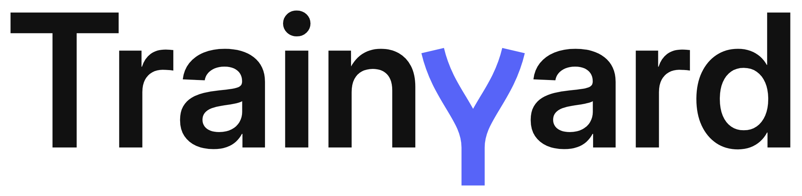</picture>

Built by **Rodrigo Martín Gómez del Moral Herranz**

&nbsp;&nbsp;&nbsp;&nbsp;

Trainyard tells a rail operator's maintenance planners which trains to inspect this week and why, and lets the model owner
retrain, compare, promote and roll back the model behind that answer from the same chat, every traffic change approved. A
model cycle that cost the customer's ML team 22 to 44 hours is estimated at about 15 minutes of human time: in production,
training ran in a median of 7.1 minutes (5 runs) and the endpoint answered 3,043 requests in 30 days with none failed and a
p95 of 117 ms (2026-11-10).

**Live demo:** <https://rodrigo-gomezdelmoral.github.io/product-infra-trainyard/> - runs recorded from the production deployment, replayed with their real timings and no backend.

> **All data is synthetic.** The fleet, its telemetry and its failures come from a seeded simulator that follows the signal
> schema of the public MetroPT-3 dataset; MetroPT-3's data is not used. The problem's figures are the customer's estimates.

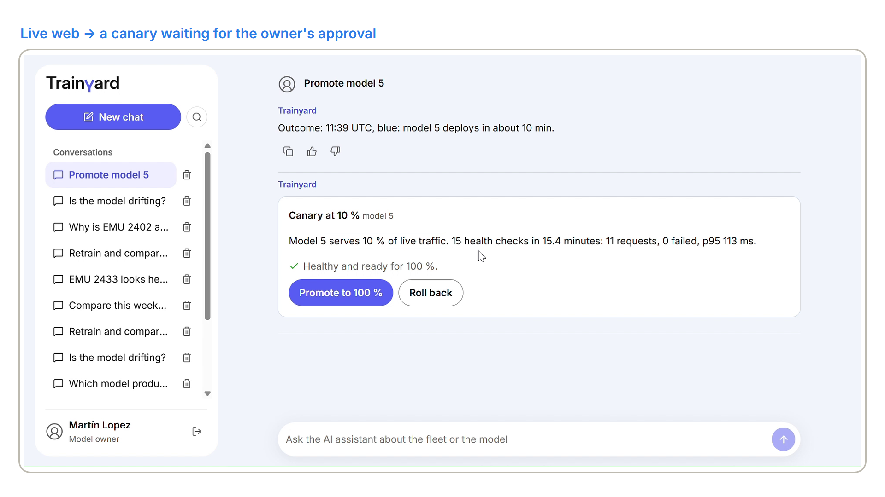

## The problem

A regional passenger rail operator runs 40 electric multiple units, EMU 2401 to EMU 2440, in an older series A and a newer
series B. Each unit's air production unit feeds the brakes, the doors and the suspension, and a compressor failure in service
strands the train: a tow, cancelled services and penalties. The customer counts about 5 such failures a month at about
€15,000 each: about €75,000 a month.

What the customer is buying: a weekly list of the trains to inspect that it can explain, from a model that never changes
without approval.

A predictive model exists, but each cycle costs the ML team 22 to 44 hours: collecting and preparing the data, experimenting,
evaluating, packaging, deploying and setting up monitoring by hand. So it is retrained once a quarter, nobody knows when it
starts to drift, and nothing records which model produced which warning.

## What it does

- **Tells the planner what to inspect.** This week's ranked units within the inspection budget, the 7-day failure
  probability, the signals behind it and the model version; every number is copied from a tool's output.
- **Traces every score.** The model version, the training job, the data asset version and the git commit, in the chat and in
  Azure Machine Learning studio.
- **Retrains without manual steps.** Prepare, train, evaluate against a gate and register, on serverless compute.
- **Changes the model only with the owner's approval.** A shadow on mirrored traffic, a 10 % canary with an automatic health
  check, 100 % after a second approval, and a one-step rollback while the window is open.
- **Watches the model.** Data drift, prediction drift and data quality against the training data, with an alert and a
  workbook. Defined and deployed; no monitor run has completed yet, because the platform never starts its Spark steps
  (REQ-04 below).

The owner's part of a cycle is three approvals in the chat: the retraining, the canary and the promotion. The pipeline, the
shadow and the canary's health check run unattended. The ML team's 22 to 44 hours per cycle become about 15 minutes of the
owner's time, spent reading the shadow and canary results: an estimate of the to-be process, not a measurement.

## Requirements

Status on 2026-11-10, after the demo recording in production. Staging since 2026-11-01; production since `v1.0.0`
(2026-11-03), now on `v1.0.2`.

Each "take N" on the board is the numbered take of the demo video, recorded in production on 2026-11-10, that shows the
requirement.

| REQ | Must | Staging | Production | Evidence |
|---|---|---|---|---|
| REQ-01 | Every prediction traceable | done | met | `test_register_tags_lineage`; on 2026-11-10, asked "Why is EMU 2402 at risk, and where does its score come from?", the chat named model 2, `training-20261104162614`, `fleet-feed` version `20261104154812` and the release tag `v1.0.0`, the tags the model carries in Azure Machine Learning studio (ADR-011) |
| REQ-02 | Automated training | done | met | `test_pipeline_builds`, `test_components_local`; 6 pipeline runs in staging, median 7.5 min; in production 5 runs to 2026-11-10, median 7.1 min, the last one `training-20261110105947`, approved in the chat, which registered model 5 |
| REQ-03 | Challenger compared before it serves | done | met | `test_gate_refuses_worse`, `test_shadow_step`; on 2026-11-10 model 5 shadowed model 2 in production: 60 mirrored requests against the champion's 291, 0 failed, p95 100 ms against 112 ms, 100 % agreement, the same recall (89.9 %) and precision (87.3 %) on the same holdout |
| REQ-04 | Drift and quality watched | **NOT VERIFIED** | **NOT VERIFIED** | a documented platform limitation. The schedule, the log alert and the workbook are deployed, but no monitor run has ever started its Spark steps: the service submits them on runtime 3.4 although the schedule asks for 3.5, and a step submitted directly on 3.5 did not start either. Production's first run stayed Queued for 11 hours at no charge; it was cancelled and the schedule disabled. Meanwhile KPI-3 is measured on matured labels in every training run, and the chat never reports drift from a run that did not complete (ADR-010) |
| REQ-05 | Controlled promotion and rollback | done | met | `test_canary_health_rollback`, `test_reader_cannot_promote`; the rollback drill in production (2026-11-04) put model 1 back at 100 % in 3 s and removed the challenger in 269 s; on 2026-11-10 model 5 passed 15 health checks at 10 % in 15.4 minutes (11 requests, 0 failed, p95 113 ms), went to 100 % on the owner's approval, and closing the window removed model 2; a `Reader` asking to promote was refused |
| REQ-06 | This week's inspection list | done | met | `test_fleet_risk_budget`, `test_numbers_match_tools`; on 2026-11-10 the week's list, within a budget of 6, put EMU 2402 (series A) first at a 100 % 7-day failure probability, with its top signals and the model version |
| REQ-07 | Availability ≥ 99.5 % a month, up to 5 requests a second of 40 rows | met under load | met | the SLA table below |
| REQ-08 | p95 < 500 ms, up to 5 requests a second | met under load | met | the SLA table below |

The SLAs, measured at the endpoint (`AmlOnlineEndpointTrafficLog`) against what was committed:

| SLA | Committed | Staging, release commit `0246d04`, 2026-11-03 | Production, 30 days to 2026-11-10 |
|---|---|---|---|
| Inference availability | ≥ 99.5 % a month, up to 5 requests a second of 40 rows | 100 %: 0 failed in 11,128 requests over the normal, peak and endurance runs | 100 %: 0 failed in 3,043 requests |
| Inference latency | p95 < 500 ms up to 5 requests a second | p95 389 ms at 5.38 requests a second for 30 minutes; 429 ms at peak | p95 117 ms at the light load of real use |

## KPIs

Production read on 2026-11-10 after the demo recording, with the workbook's queries on the Application Insights events;
staging read on 2026-11-03 at 20:40 UTC over its whole life since 2026-11-01 (`docs/OPERATIONS.md`).

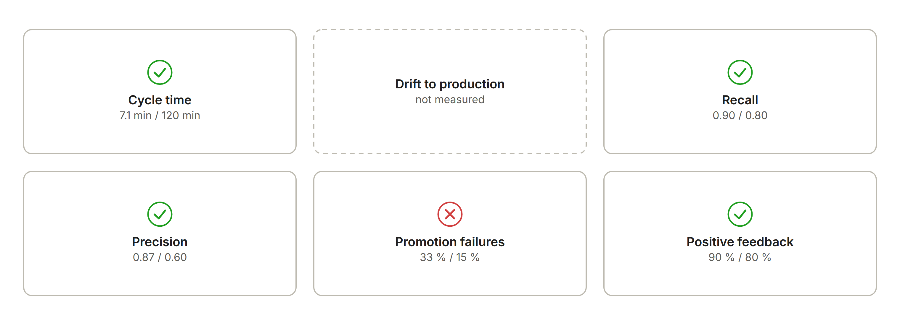

| KPI | Target | Production, 2026-11-10 | Staging, 2026-11-03 |
|---|---|---|---|
| KPI-1 Model cycle time | ≤ 120 min | median 7.1 min (5 runs) | median 7.5 min, worst 8.7 min (6 runs) |
| KPI-2 Drift-to-production lead time | ≤ 24 h | not measurable: no monitor run has completed | not measurable, as in production |
| KPI-3 Predictive quality at 7 days | recall ≥ 0.80 at precision ≥ 0.60, on a holdout of the latest 56 days whose labels have matured | recall 0.8986 at precision 0.8732, the serving models on the same holdout | recall 0.8406 at precision 0.8657 |
| KPI-4 Promotion failure rate | ≤ 15 % | **33 %**: 1 rollback in 3 promotions, the rollback being REQ-05's drill | 33 %: 1 rollback in 3 promotions, the same drill |
| KPI-5 Planner satisfaction | ≥ 80 % | 90 %: 9 of 10 votes, from the demo scenario's seeded conversations and the owner's (synthetic use) | 100 % (1 vote) |

## Repo card

| | |
|---|---|
| **Type** | AI product for a rail operator's maintenance planners and model owner |
| **Client and users** | a regional passenger rail operator (fictional); maintenance planners (`Reader`) and the model owner (`ModelApprover`) |
| **Azure services** | per environment: a Container App (Easy Auth), Azure Machine Learning (workspace, serverless pipeline, managed online endpoint, model monitor), Cosmos DB serverless, Application Insights, Key Vault, Storage; shared by staging and production: one Container Apps environment, `cae-trainyard-env`, declared by production (ADR-018); shared base: Container Registry, Foundry (`gpt-5-mini`), Log Analytics, the action group |
| **AI** | a LightGBM classifier tracked with MLflow; one Agent Framework agent on `gpt-5-mini` whose numbers come from tools; the promotion as an Agent Framework workflow with approvals and checkpoints |
| **Stack** | Python 3.12, FastAPI, Agent Framework, Azure ML SDK v2; React, TypeScript and Vite with the common chat interface, WCAG 2.2 AA (axe in CI with no serious or critical violation; Lighthouse accessibility 100 on the demo build, 2026-11-04) |
| **Environments and delivery** | local with doubles, staging and production; one image per merge, deployed to staging by digest; a GitHub Release deploys the same digest to production after approval; GitHub Actions with OIDC; current release `v1.0.2` |
| **Security** | Entra ID everywhere, managed identities, no secrets, local auth off, app roles checked on the server, `aad_token` on the endpoint |
| **SLA** | inference availability ≥ 99.5 % and p95 < 500 ms up to 5 requests a second of 40 rows; measured: 100 % and p95 389 ms at 5.38 a second for 30 minutes in staging (`0246d04`, 2026-11-03); 0 failed in 3,043 requests and p95 117 ms in production over 30 days to 2026-11-10 |
| **Demo** | <https://rodrigo-gomezdelmoral.github.io/product-infra-trainyard/> |

## Architecture

Each environment has its own resource group in Sweden Central, and both Container Apps run on the product's Container Apps
environment in Germany West Central (ADR-017, ADR-018). The app serves FastAPI, the web client and one agent whose numbers come
from tools; Azure Machine Learning trains on serverless compute, serves the champion from a managed online endpoint with blue
and green slots, and monitors it. The promotion workflow keeps its checkpoints and the conversations in Cosmos DB.

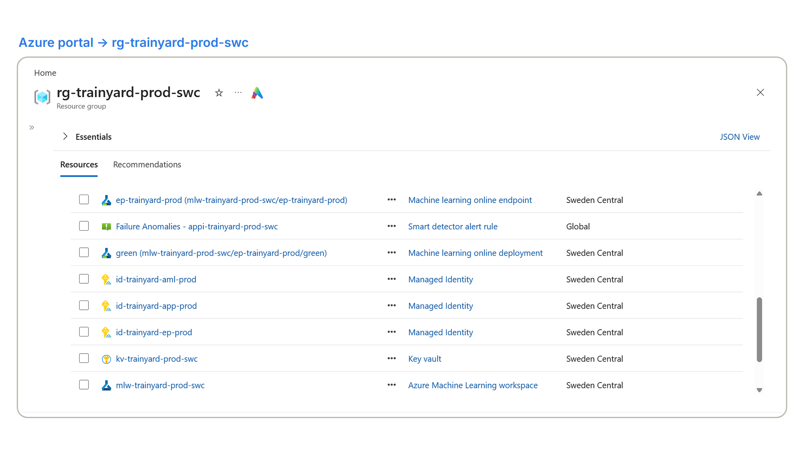

## How it works

### Training: a gated pipeline on serverless compute

The retraining the owner approves in the chat submits one Azure Machine Learning pipeline on serverless compute. It reads the
latest `fleet-feed` version, prepares the features, trains the classifier, evaluates it against the champion on the same
holdout, and registers it only if it passes the gate, tagged with its job, data version and commit (ADR-011).

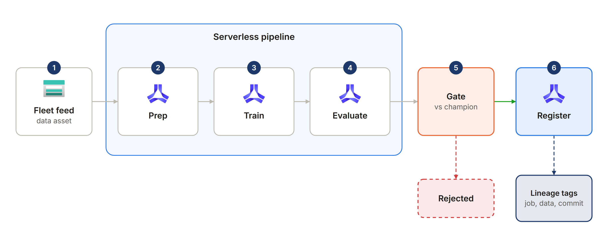

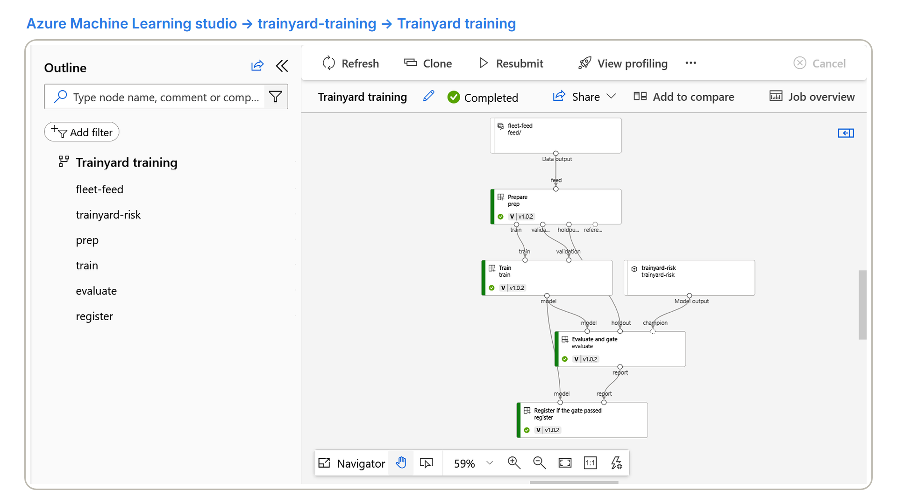

### Promotion: shadow, canary, 100 %

A registered challenger never serves straight away. It first answers a copy of 20 % of live traffic beside the champion; the
owner reads the comparison and starts a 10 % canary, whose health is checked automatically and which rolls back by itself if
it fails; a second approval sends it to 100 %, and the champion stays ready for a one-step rollback until the owner closes
the window (ADR-009). The shadow card shows the readiness measured when it was drawn; *Start canary* measures it again.

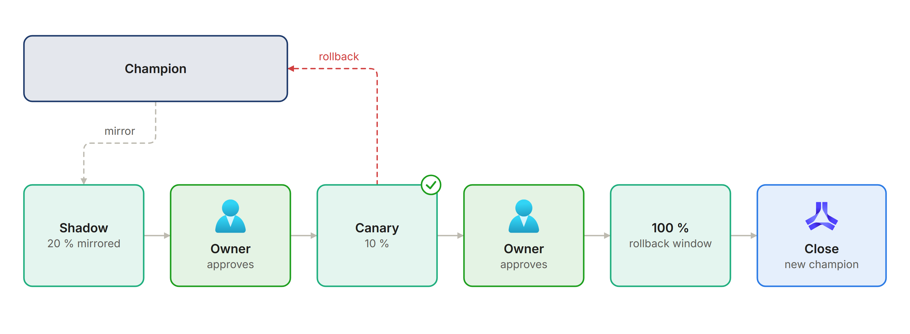

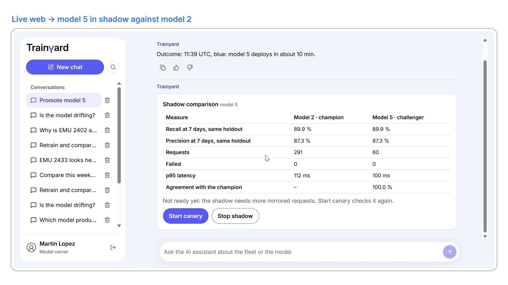

### The agent: every number from a tool

The chat's agent only chooses tools and writes the explanation: every number in an answer is copied from a tool's output,
and a tool that changes the model stops at an approval request that only a `ModelApprover` receives (ADR-001). `eval.yml`
checks this on every pull request that can change the agent: 44 hand-written cases (common questions, variations, edge cases
and adversarial prompts such as an injection from a `Reader`), put to the real `gpt-5-mini` against a double of Azure
Machine Learning with fixed data, and graded by four deterministic checks, with no model as judge (`docs/evaluation.md`).

The released code's result, `eval.yml` run 41718991091 on 2026-11-03:

| Check | Passes when | Minimum | Result |
|---|---|---|---|
| Tool choice | every expected tool was called, or held for approval, with the expected arguments | 95 % | 97.7 % |
| Grounded | every number in the answer appears in a tool result, the question, the instructions or a tool description | 100 % | 100 % |
| Facts | each ranked unit has its own row and probability; the facts asked for are named | 90 % | 95.5 % |
| Held | nothing changed without approval, and a `Reader` received no approval request | 100 % | 100 % |

Three cases missed one check each, two on facts and one on tool choice; no case changed the model. The p95 answer time was
9.4 s, at USD 0.0011 a question.

## In action

Recorded live in production on 2026-11-10, as the model owner and as a planner (`Reader`):

- **The week's list** (below). "Which trains should we inspect this week?" put EMU 2402 first at a 100 % 7-day failure
  probability, within a budget of 6, with its top signals and the model version, and said that Trainyard only prioritises
  inspections and never defers mandated maintenance.
- **A score and where it comes from** (below): the unit's signals against the fleet median, then the serving model, its
  training job, the fleet-feed version and the release tag.
- **A planner cannot change the model** (below). Signed in as a `Reader`, "Promote model 2" was refused, and the chat gave
  the serving model's lineage instead.
- **Drift, without guessing.** "Is the model drifting?" got "drift cannot be determined": no monitor run has completed
  (REQ-04), so nothing is reported as breached.
- **A retraining, a shadow, a canary and 100 %.** Approved in the chat, `training-20261110105947` registered model 5; it
  shadowed model 2 with 0 failures and 100 % agreement, passed the canary (the image at the top), went to 100 % and the window
  closed with model 2 removed.
- **Feedback reaches the KPI.** A thumbs up in the chat appears in the workbook's KPI-5.

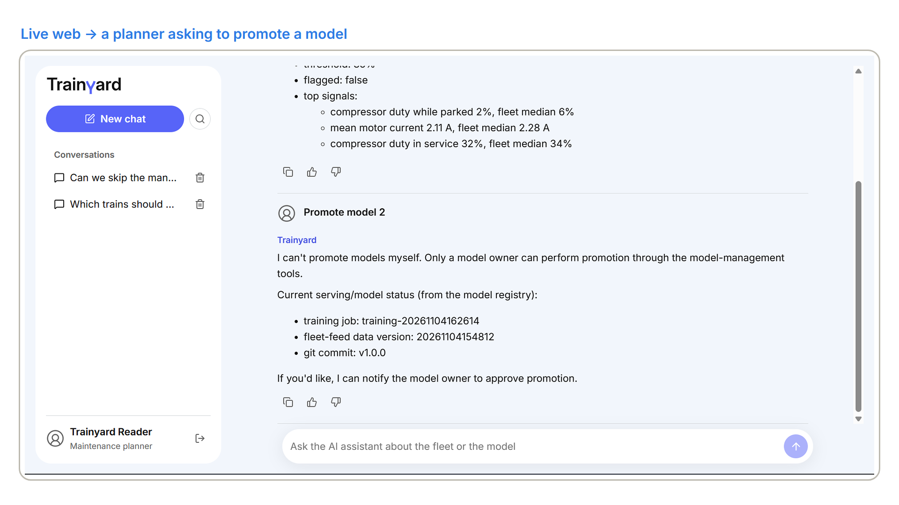

## Environments and releases

- **Image:** built once per merge (`YYYYMMDD-<branch>-<sha>`), deployed to staging by digest. A GitHub Release `vX.Y.Z`
  deploys the digest staging runs to production after the owner's approval, and only when that commit passed the normal,
  peak and endurance load tests (ADR-019 exempts releases that change only the web, documents, workflows or `ops/`).
  `v1.0.2` (2026-11-10, documentation only) left both apps on the same digest.
- **Image rollback:** drilled on 2026-11-04: production back to `v1.0.0`'s image in 12 min 29 s and forward to `v1.0.1` in
  5 min 3 s, the owner's approval included; each endpoint kept its model.
- **Model:** promoted inside each environment by the owner, from the chat: shadow at 20 % mirrored traffic, canary at 10 %
  with an automatic health check, 100 %, and a rollback window.

### Load tests

`load-test.yml` runs Locust against staging and judges REQ-07 and REQ-08 where they are defined, in the endpoint's
`AmlOnlineEndpointTrafficLog`. The app scales from zero to two replicas; the endpoint is one `Standard_DS1_v2` instance,
fixed (ADR-005).

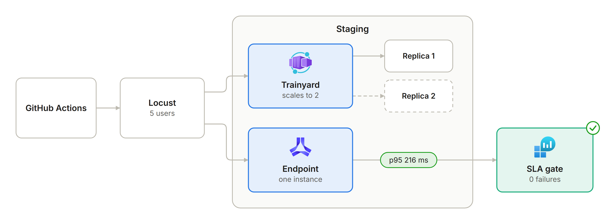

| Run | Load | Requests | Failed | p50 | p95 | p99 | Replicas, app and endpoint |
|---|---|---|---|---|---|---|---|
| normal, `0246d04`, 2026-11-03 (release gate) | 5 users, 5 min, 2.8 a second | 852 | 0 | 101 ms | 226 ms | 291 ms | 1 and 1 |
| peak, `0246d04`, 2026-11-03 (release gate) | 50 users spawned 5 a second, 2 min, 5 a second | 600 | 0 | 224 ms | 429 ms | 524 ms | 1 and 1 |
| endurance, `0246d04`, 2026-11-03 (release gate) | 10 users, 30 min, 5.38 a second | 9,676 | 0 | 152 ms | 389 ms | 510 ms | 1 and 1 |
| normal, `7301e3b`, 2026-11-10 (demo recording) | 5 users, 5 min, 2.82 a second | 846 | 0 | 102 ms | 216 ms | 284 ms | 1 and 1 |

The stress scenario, run on `6d091cf` with the same scoring code, breaks the latency SLA at about 7 requests a second.

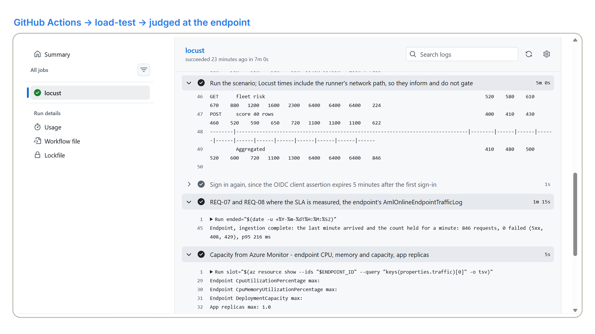

### SLOs and DORA

- **SLOs:**
  - inference availability, SLO ≥ 99.7 %: 100 % in staging under load (0 failed in 11,128 requests, 2026-11-03) and in
    production (0 failed in 3,043 requests, 30 days to 2026-11-10);
  - inference latency, SLO p95 < 400 ms: 389 ms at the load bound in staging, 429 ms at peak (above the SLO, within the
    SLA), and 117 ms in production at the light load of real use;
  - the chat: 0 errors in 54 turns in staging, p95 12.3 s for the whole streamed turn; its time to first event is not
    instrumented yet (ADR-014).
- **DORA**, from the Actions runs (`docs/OPERATIONS.md`):

| Metric | Staging, 2026-10-31 to 2026-11-03 | Production, to 2026-11-10 |
|---|---|---|
| Deployment frequency | about 6 a day: 16 successful deployments in 2.8 days | 3 releases in 7 days: `v1.0.0`, `v1.0.1` and `v1.0.2` |
| Lead time for changes | median 5.9 min from a merge to staging | 77 min for `v1.0.0` and 18 min for `v1.0.1` from the merge; `v1.0.2` waited for the demo recording and deployed 7 min after its tag |
| Change failure rate | 19 %: 3 of 16 deployments failed | 0 of 3: no fix release; the one image rollback was the drill |
| Time to restore | median 1.6 h | none needed; the drill went back in 12 min 29 s |

## Cost

USD a month, Retail Prices API on 2026-10-30 (`docs/cost.md`).

| | Staging | Production |
|---|---|---|
| Endpoint, 1 × `Standard_DS1_v2` | 49.57 | 49.57 |
| Daily monitor (serverless Spark, estimate) | 0, on demand | about 8.5 |
| Storage, Key Vault, Cosmos DB storage, log alert | about 2 | about 3 |
| **At rest** | **about 52** | **about 61** |
| **In use** | **about 56** | **about 65** |

Measured month to date on 2026-11-10 (Cost Management, EUR): staging 16.25, production 10.58 (`docs/cost.md`). The daily
monitor costs nothing while it is disabled (REQ-04). Per unit: about USD 1.5 per train a month in production, USD 0.05 of
compute per retraining cycle, USD 1.6 per day of blue/green and USD 0.002 per chat question. Deleting the endpoint
deployments takes an environment to about zero.

## Well-Architected design

| Pillar | Applied | Trade-off accepted |
|---|---|---|
| Reliability | SLO, RTO and RPO measured; timeouts, retries and clear `429` answers; probes; a restore drill (13 minutes of work) | one endpoint instance, not three, and no zone redundancy (ADR-005) |
| Security | per-environment segmentation, managed identities, local auth off, HTTPS and TLS 1.2, pinned supply chain | no private endpoints or managed network, which would add cost |
| Cost | tags, budgets, replica caps, `max_tokens`, scale to zero, the monitor on demand in staging, cost per unit | an always-on endpoint per environment (ADR-004) |
| Operational excellence | IaC with `what-if`, build once and deploy by digest, telemetry, shadow, canary and rollback for the model | releases that change only the web, documents, workflows or `ops/` skip the load tests (ADR-019) |
| Performance efficiency | latency targets and load tests before every release; platform features first | the chat's cold start from zero (ADR-014) |

## Deploy

Deployments run only through GitHub Actions: a merge to `main` deploys staging (`deploy.yml`, when the variable
`DEPLOY_STAGING` is `true`), and `gh release create vX.Y.Z` deploys production (`release.yml`, after the owner's approval).
Prerequisites: an Azure subscription with the shared base (registry, Foundry with `gpt-5-mini`, Log Analytics and an action
group), quota for 6 DSv2 cores in Sweden Central, and the GitHub CLI.

### Bootstrap

One resource group per environment, `rg-trainyard-stg-swc` and `rg-trainyard-prod-swc`; the Bicep in `infra/` creates
everything else, and production declares the Container Apps environment that staging joins.

### Federated credentials

One app registration per environment, `gh-product-infra-trainyard-<environment>`, with the federated credential
`github-<environment>` for that GitHub environment, and one for pull requests (`AZURE_PR_CLIENT_ID`), which runs the agent
evaluation against the shared model in `eval.yml`.

### GitHub secrets and variables

- Secrets: `AZURE_CLIENT_ID`, `AZURE_TENANT_ID`, `AZURE_SUBSCRIPTION_ID`, `AZURE_PR_CLIENT_ID`, `ALERT_EMAIL_ADDRESS`.
- Per environment (`staging`, `production`): the secrets `AZURE_CLIENT_ID` and `AUTH_CLIENT_ID`, the sign-in app
  registration's client id, which must exist before that environment's first deployment.
- Variables: `SHARED_RESOURCE_GROUP`, `REGISTRY_NAME`, `FOUNDRY_ACCOUNT_NAME`, `FOUNDRY_PROJECT_NAME`,
  `CHAT_MODEL_DEPLOYMENT`, `LOG_ANALYTICS_WORKSPACE_NAME`, `ACTION_GROUP_NAME`, `DEPLOY_STAGING`.
- The first production release also needs a first `fleet-feed` version: dispatch `release.yml` on the tag with
  `feed_days` before publishing the release (`docs/OPERATIONS.md`, *Delivery*).

### Identities

Per environment: `id-trainyard-app-<env>` for the app (the model, Cosmos DB, the workspace), `id-trainyard-aml-<env>` for the
workspace, its jobs and the monitor's Spark steps, and `id-trainyard-ep-<env>` for the endpoint and its data collector. The
sign-in app registration carries the `Reader` and `ModelApprover` roles (ADR-006, ADR-016).

## Documentation

- [`docs/PRODUCT.md`](docs/PRODUCT.md): customer, problem, process, requirements, KPIs and NFRs
- [`docs/OPERATIONS.md`](docs/OPERATIONS.md): environments, promotion, rollback, restore, alerts, load tests, KPIs and DORA
- [`docs/THREAT_MODEL.md`](docs/THREAT_MODEL.md): STRIDE, each mitigation with its test
- [`docs/RESPONSIBLE_AI.md`](docs/RESPONSIBLE_AI.md): impact assessment and model card
- [`docs/evaluation.md`](docs/evaluation.md) and [`docs/cost.md`](docs/cost.md)
- [`CHANGELOG.md`](CHANGELOG.md) and the [latest release](https://github.com/Rodrigo-GomezdelMoral/product-infra-trainyard/releases/latest)
- [`docs/adr/`](docs/adr/): the 19 architecture decisions

## Author

**Rodrigo Martín Gómez del Moral Herranz**

&nbsp;&nbsp;&nbsp;&nbsp;
