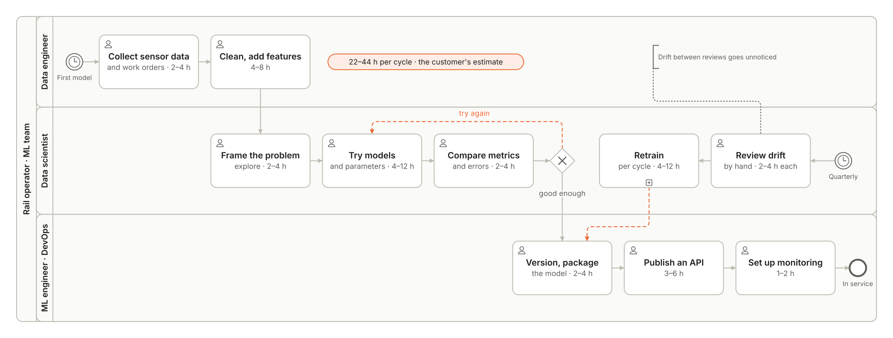
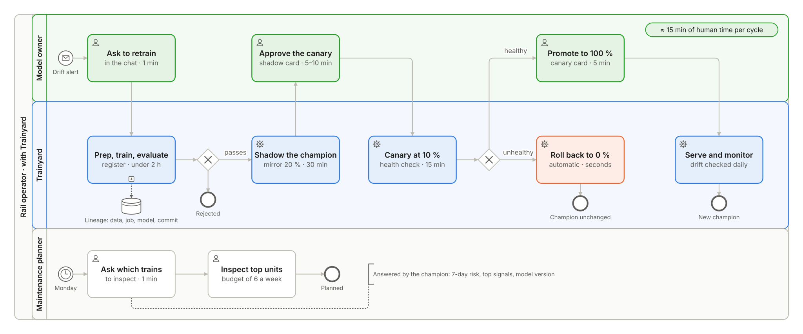
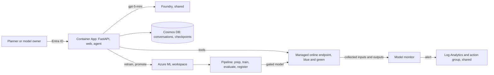

# 

Built by **Rodrigo Martín Gómez del Moral Herranz**

&nbsp;&nbsp;&nbsp;&nbsp;

Which trains should we inspect this week, and why? Trainyard answers a rail operator's maintenance planners with the units
most likely to lose their air compressor in the next 7 days, and lets the model owner retrain, compare, promote and roll back
the model behind that answer from the same chat. A model cycle that took the customer's ML team 22 to 44 hours is estimated
at about 15 minutes of human time: training ran in a median of 7.5 minutes in staging (6 runs, 2026-11-01 to 2026-11-03) and
in 7.3 minutes in production, and every traffic change waits for the owner's approval.

**Live demo:** <https://rodrigo-gomezdelmoral.github.io/product-infra-trainyard/> - runs recorded from the production deployment, replayed with their real timings and no backend.

> **All data is synthetic.** The fleet, its telemetry and its failures come from a seeded simulator that follows the signal
> schema of the public MetroPT-3 dataset; MetroPT-3's data is not used. The problem's figures are the customer's estimates.

## The problem

A regional passenger rail operator runs 40 electric multiple units, EMU 2401 to EMU 2440, in an older series A and a newer
series B. Each unit's air production unit feeds the brakes, the doors and the suspension, and a compressor failure in service
strands the train: a tow, cancelled services and penalties. The customer counts about 5 such failures a month at about
€15,000 each.

A predictive model exists, but each cycle costs the ML team 22 to 44 hours: collecting and preparing the data, experimenting,
evaluating, packaging, deploying and setting up monitoring by hand. So it is retrained once a quarter, nobody knows when it
starts to drift, and nothing records which model produced which warning.

## What it does

- **Tells the planner what to inspect.** This week's ranked units within the inspection budget, the 7-day failure
  probability, the signals behind it and the model version; every number is copied from a tool's output.
- **Traces every score.** The model version, the training job, the data asset version and the git commit, in the chat and in
  Azure Machine Learning studio.
- **Retrains without manual steps.** Prepare, train, evaluate against a gate and register, on serverless compute.
- **Changes the model only with the owner's approval.** A shadow on mirrored traffic, a 10 % canary with an automatic health
  check, 100 % after a second approval, and a one-step rollback while the window is open.
- **Watches the model.** Data drift, prediction drift and data quality against the training data, with an alert and a
  workbook. Defined and deployed; no monitor run has completed yet, because the platform never starts its Spark steps
  (REQ-04 below).

## Requirements

Status on 2026-11-04. Staging since 2026-11-01; production since `v1.0.0` (2026-11-03, 22:26 UTC).

| REQ | Must | Staging | Production | Evidence |
|---|---|---|---|---|
| REQ-01 | Every prediction traceable | done | named in the chat | `test_register_tags_lineage`; asked "Where does that score come from?", the chat named `training-20261102101927`, `fleet-feed` version `20261101131623` and commit `0b70d87` for the serving model; in production (2026-11-04) it named `training-20261103222555`, `fleet-feed` `20261103222125` and the release tag `v1.0.0` (ADR-011) |
| REQ-02 | Automated training | done | met | `test_pipeline_builds`, `test_components_local`; 6 pipeline runs on serverless compute in staging, median 7.5 min; in production `training-20261103222555`, started by the release, 7.3 min, model 1 gated and registered; a retraining approved in the chat on 2026-11-04 (`training-20261104162614`, firmware-b feed) registered model 2 in 8 min |
| REQ-03 | Challenger compared before it serves | done | met | `test_gate_refuses_worse`, `test_shadow_step`; model 4 in shadow, 147 mirrored requests, 0 failed, p95 about 105 ms; in production model 2 in shadow at 20 % from 16:49 UTC, 0 failed, p95 105 to 111 ms on the card |
| REQ-04 | Drift and quality watched | **NOT VERIFIED** | **NOT VERIFIED** | a documented platform limitation. The schedule, the log alert and the workbook are deployed, but no monitor run has ever started its Spark steps: the service submits them on runtime 3.4 although the schedule asks for 3.5, and a step submitted directly on 3.5 did not start either. Production's first run (2026-11-04, 03:15 UTC) stayed Queued for 11 hours at no charge; it was cancelled and the schedule disabled. Meanwhile KPI-3 is measured on matured labels in every training run, and the chat never reports drift from a run that did not complete (ADR-010) |
| REQ-05 | Controlled promotion and rollback | done | met | `test_canary_health_rollback`, `test_reader_cannot_promote`; a rollback in the window, then canary at 10 % and promotion to 100 % of model 4; in production (2026-11-04) Roll back from the canary put model 1 back at 100 % in 3 s and removed the challenger in 269 s, then model 2 went through shadow, canary and 100 % and the window closed at 19:54 UTC; a `Reader` asking to promote was refused |
| REQ-06 | This week's inspection list | done | met | `test_fleet_risk_budget`, `test_numbers_match_tools`; in production the week's list (budget 6) put EMU 2402 first at 99 % |
| REQ-07 | Availability ≥ 99.5 % a month, up to 5 requests a second of 40 rows | met under load | 0 failed in 1,964 | release commit `0246d04`: 0 failed in 11,128 endpoint requests over the normal, peak and endurance runs; 100 % over 9,676 requests at 5.38 a second for 30 minutes; production, 2026-11-04 16:20 to 20:05 UTC: 0 failed in 1,964 endpoint requests (the owner's traffic during the walk-through) |
| REQ-08 | p95 < 500 ms, up to 5 requests a second | met under load | p95 119 ms | `0246d04`: p95 389 ms in the same 30 minutes, 429 ms at peak, 226 ms at normal load; production on 2026-11-04: p95 119 ms (model 1) and 112 ms (model 2) at light load |

## KPIs

Staging read on 2026-11-03 at 20:40 UTC over its whole life since 2026-11-01; production read on 2026-11-04 since 2026-11-03
(`docs/OPERATIONS.md`). KPI-1 is the events' figure; on the jobs' own timestamps staging gives a median of 7.6 and a worst of 8.8 min.

| KPI | Target | Staging | Production |
|---|---|---|---|
| KPI-1 Model cycle time | ≤ 120 min | median 7.5 min, worst 8.7 min (6 runs) | 7.1 min (1 run); model 2 on 2026-11-04 registered about 8 min after the approval |
| KPI-2 Drift-to-production lead time | ≤ 24 h | not measurable: no monitor run has completed | not measurable, as in staging |
| KPI-3 Predictive quality at 7 days | recall ≥ 0.80 at precision ≥ 0.60 | recall 0.8406 at precision 0.8657 | recall 0.8986 at precision 0.8732 |
| KPI-4 Promotion failure rate | ≤ 15 % | 33 %, the one rollback being REQ-05's drill (3 promotions) | 50 %, the one rollback being REQ-05's drill in production (2 promotions of model 2, 2026-11-04) |
| KPI-5 Planner satisfaction | ≥ 80 % | 100 % (1 vote) | 100 % (1 vote, the owner's, in the walk-through of 2026-11-04) |

## Repo card

| | |
|---|---|
| **Type** | AI product for a rail operator's maintenance planners and model owner |
| **Client and users** | a regional passenger rail operator (fictional); maintenance planners (`Reader`) and the model owner (`ModelApprover`) |
| **Azure services** | per environment: Container Apps (Easy Auth), Azure Machine Learning (workspace, serverless pipeline, managed online endpoint, model monitor), Cosmos DB serverless, Application Insights, Key Vault, Storage; shared: Container Registry, Foundry (`gpt-5-mini`), Log Analytics, the action group |
| **AI** | a LightGBM classifier tracked with MLflow; one Agent Framework agent on `gpt-5-mini` whose numbers come from tools; the promotion as an Agent Framework workflow with approvals and checkpoints |
| **Stack** | Python 3.12, FastAPI, Agent Framework, Azure ML SDK v2; React, TypeScript and Vite with the common chat interface |
| **Environments and delivery** | local with doubles, staging and production; one image per merge, deployed to staging by digest; a GitHub Release deploys the same digest to production after approval; GitHub Actions with OIDC |
| **Security** | Entra ID everywhere, managed identities, no secrets, local auth off, app roles checked on the server, `aad_token` on the endpoint |
| **SLA** | inference availability ≥ 99.5 % and p95 < 500 ms up to 5 requests a second of 40 rows; measured in staging on the release commit `0246d04`: 100 % and p95 389 ms over 30 minutes at 5.38 a second, p95 429 ms at peak |
| **Accessibility** | WCAG 2.2 AA: axe in CI on the release commit, keyboard flows included, with no serious or critical violation; Lighthouse accessibility 100 on the demo build (2026-11-04) |
| **Demo** | <https://rodrigo-gomezdelmoral.github.io/product-infra-trainyard/> |

## Architecture

Each environment has its own resource group in Sweden Central and its own Container App in Germany West Central (ADR-017,
ADR-018). The app serves FastAPI, the web client and one agent that chooses tools and writes the explanation. Azure Machine
Learning trains on serverless compute, serves the model from a managed online endpoint with blue and green slots and a data
collector, and monitors it. The promotion workflow keeps its checkpoints and the conversations in Cosmos DB. The champion is
whatever serves 100 % of live traffic.

## Environments and releases

- **Image:** built once per merge (`YYYYMMDD-<branch>-<sha>`), deployed to staging by digest. A GitHub Release `vX.Y.Z`
  deploys the digest staging runs to production after the owner's approval, and only when that commit passed the normal,
  peak and endurance load tests (ADR-019 exempts later releases that change only the web, documents or workflows).
- **Model:** promoted inside each environment by the owner, from the chat: shadow, canary, promotion, window.
- **Load tests** (`load-test.yml`, Locust, staging), judged at the endpoint's `AmlOnlineEndpointTrafficLog`; release
  commit `0246d04` of `v1.0.0`, 2026-11-03 (earlier runs are history in `docs/OPERATIONS.md`):

| Scenario | Load | Requests | Failed | p95 | Result |
|---|---|---|---|---|---|
| normal | 5 users, 5 min, 2.8 a second | 852 | 0 | 226 ms | passed |
| peak | 50 users spawned 5 a second, 2 min, 5 a second | 600 | 0 | 429 ms | passed: SLA met, 29 ms over the 400 ms SLO |
| endurance | 10 users, 30 min, 5.38 a second | 9,676 | 0 | 389 ms | passed |

  The stress scenario, run on `6d091cf` with the same scoring code, breaks the latency SLA at about 7 requests a second.
- **SLOs:** inference p95 389 ms against an SLO of 400 ms at the load bound, 429 ms at peak. The chat had 0 errors in
  54 turns in staging, p95 12.3 s for the whole streamed turn; its time to first event is not instrumented yet (ADR-014).
- **DORA:** staging (2026-10-31 to 2026-11-03) about 6 deployments a day, lead time from merge to staging median
  5.9 minutes, change failure rate 19 % (3 of 16), time to restore median 1.6 h. Production: `v1.0.0` deployed 77 minutes
  after its merge, on the third attempt of its run: the first release on a fresh environment needs the sign-in app and a
  first fleet feed beforehand (`docs/OPERATIONS.md`).

## Cost

USD a month, Retail Prices API on 2026-10-30 (`docs/cost.md`).

| | Staging | Production |
|---|---|---|
| Endpoint, 1 × `Standard_DS1_v2` | 49.57 | 49.57 |
| Daily monitor (serverless Spark, estimate) | 0, on demand | about 8.5 |
| Storage, Key Vault, Cosmos DB storage, log alert | about 2 | about 3 |
| **At rest** | **about 52** | **about 61** |
| **In use** | **about 56** | **about 65** |

Measured month to date on 2026-11-04 (Cost Management, EUR): staging 6.61, production 0.52 (`docs/cost.md`). The daily
monitor costs nothing while it is disabled (REQ-04). Per unit: about USD 1.5 per train a month in production, USD 0.05 of compute per retraining cycle, USD 1.6 per day of
blue/green and USD 0.002 per chat question. Deleting the endpoint deployments takes an environment to about zero.

## Well-Architected design

| Pillar | Applied | Trade-off accepted |
|---|---|---|
| Reliability | SLO, RTO and RPO measured; timeouts, retries and clear `429` answers; probes; a restore drill (13 minutes of work) | one endpoint instance, not three, and no zone redundancy (ADR-005) |
| Security | per-environment segmentation, managed identities, local auth off, HTTPS and TLS 1.2, pinned supply chain | no private endpoints or managed network, which would add cost |
| Cost | tags, budgets, replica caps, `max_tokens`, scale to zero, the monitor on demand in staging, cost per unit | an always-on endpoint per environment (ADR-004) |
| Operational excellence | IaC with `what-if`, build once and deploy by digest, telemetry, shadow, canary and rollback for the model | |
| Performance efficiency | latency targets and load tests before every release; platform features first | the chat's cold start from zero (ADR-014) |

## Deploy

Deployments run only through GitHub Actions: a merge to `main` deploys staging (`deploy.yml`, when the variable
`DEPLOY_STAGING` is `true`), and `gh release create vX.Y.Z` deploys production (`release.yml`, after the owner's approval).
Prerequisites: an Azure subscription with the shared base (registry, Foundry with `gpt-5-mini`, Log Analytics and an action
group), quota for 6 DSv2 cores in Sweden Central, and the GitHub CLI.

### Bootstrap

One resource group per environment, `rg-trainyard-stg-swc` and `rg-trainyard-prod-swc`; the Bicep in `infra/` creates
everything else, and production declares the Container Apps environment that staging joins.

### Federated credentials

One app registration per environment, `gh-product-infra-trainyard-<environment>`, with the federated credential
`github-<environment>` for that GitHub environment, and one for pull requests (`AZURE_PR_CLIENT_ID`), which runs the agent evaluation against the shared model in `eval.yml`.

### GitHub secrets and variables

- Secrets: `AZURE_CLIENT_ID`, `AZURE_TENANT_ID`, `AZURE_SUBSCRIPTION_ID`, `AZURE_PR_CLIENT_ID`, `ALERT_EMAIL_ADDRESS`.
- Per environment (`staging`, `production`): the secrets `AZURE_CLIENT_ID` and `AUTH_CLIENT_ID`, the sign-in app
  registration's client id, which must exist before that environment's first deployment.
- Variables: `SHARED_RESOURCE_GROUP`, `REGISTRY_NAME`, `FOUNDRY_ACCOUNT_NAME`, `FOUNDRY_PROJECT_NAME`,
  `CHAT_MODEL_DEPLOYMENT`, `LOG_ANALYTICS_WORKSPACE_NAME`, `ACTION_GROUP_NAME`, `DEPLOY_STAGING`.
- The first production release also needs a first `fleet-feed` version: dispatch `release.yml` on the tag with
  `feed_days` before publishing the release (`docs/OPERATIONS.md`, *Delivery*).

### Identities

Per environment: `id-trainyard-app-<env>` for the app (the model, Cosmos DB, the workspace), `id-trainyard-aml-<env>` for the
workspace, its jobs and the monitor's Spark steps, and `id-trainyard-ep-<env>` for the endpoint and its data collector. The
sign-in app registration carries the `Reader` and `ModelApprover` roles (ADR-006, ADR-016).

## Documentation

- [`docs/PRODUCT.md`](docs/PRODUCT.md): customer, problem, process, requirements, KPIs and NFRs
- [`docs/OPERATIONS.md`](docs/OPERATIONS.md): environments, promotion, rollback, restore, alerts, load tests, KPIs and DORA
- [`docs/THREAT_MODEL.md`](docs/THREAT_MODEL.md): STRIDE, each mitigation with its test
- [`docs/RESPONSIBLE_AI.md`](docs/RESPONSIBLE_AI.md): impact assessment and model card
- [`docs/evaluation.md`](docs/evaluation.md) and [`docs/cost.md`](docs/cost.md)
- [`CHANGELOG.md`](CHANGELOG.md) and the [latest release](https://github.com/Rodrigo-GomezdelMoral/product-infra-trainyard/releases/latest)
- [`docs/adr/`](docs/adr/): the 19 architecture decisions

## Author

**Rodrigo Martín Gómez del Moral Herranz**

&nbsp;&nbsp;&nbsp;&nbsp;
