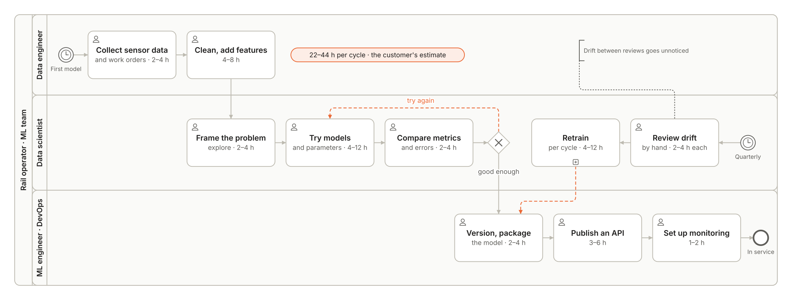
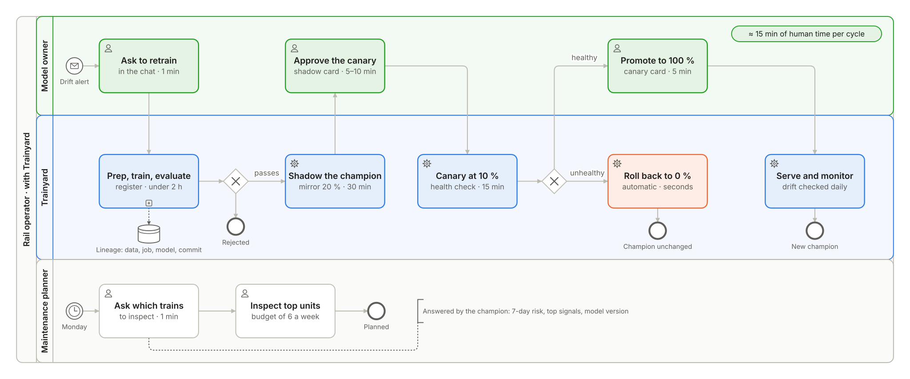

# Trainyard · product

> **All data in this repository is synthetic.** The fleet, its telemetry and its failures are generated by a documented, seeded simulator that follows the signal schema of the public MetroPT-3 dataset (UCI Machine Learning Repository); MetroPT-3's data is not used. The figures that describe the problem below are the customer's own estimates and are labelled as such.

Trainyard gives a rail operator's maintenance planners a weekly, explained list of the trains most likely to suffer an air production unit failure in the next 7 days, and gives the model owner a governed way to retrain, compare, promote and roll back the model behind it.

## Customer

A regional passenger rail operator running a fleet of **40 electric multiple units**, EMU 2401 to EMU 2440, in two series: **A**, older, and **B**, newer. Every unit has an **air production unit (APU)** whose compressor feeds the brakes, the doors and the suspension. A compressor failure in service strands the train: it has to be towed, services are cancelled and the operator pays contractual penalties.

## Problem

The customer's figures:

| | Customer's figure |
|---|---|
| In-service APU failures | about 5 a month across the fleet |
| Cost of one failure (tow, cancellations, penalties) | about €15,000 |
| Monthly cost of failures | about €75,000 (5 × €15,000) |
| Human time per model cycle | 22–44 hours (the as-is process below) |
| Retraining cadence | once a quarter |

A predictive model already exists, but each cycle is so expensive that it is retrained once a quarter. Nobody knows when it starts to drift between reviews, and nothing records which model produced which warning, so no audit question about a missed failure can be answered.

## Users and roles

Both roles sign in with Microsoft Entra ID; the role is an app role of the Trainyard application.

| Role | App role | What they do |
|---|---|---|
| Maintenance planner | `Reader` | asks which trains to inspect this week and why |
| ML engineer, model owner | `ModelApprover` | starts retraining, compares models, approves each promotion step, rolls back |

A `Reader` never sees the tools that change the model.

## Process

### As-is

The customer's process for one model cycle, with the time of each task as the customer estimates it.

| # | Task | Role | Time |
|---|---|---|---|
| 1 | Collect sensor exports and maintenance work orders | Data engineer | 2–4 h |
| 2 | Clean the data, handle missing values, build features | Data engineer | 4–8 h |
| 3 | Explore the data and frame the predictive problem | Data scientist | 2–4 h |
| 4 | Develop models, try algorithms and parameters | Data scientist | 4–12 h |
| 5 | Compare metrics and analyse errors | Data scientist | 2–4 h |
| 6 | Version the model and prepare its deployment | ML engineer | 2–4 h |
| 7 | Configure the hosting environment and publish an API | ML engineer or DevOps | 3–6 h |
| 8 | Set up monitoring of latency and errors | ML engineer | 1–2 h, once |
| 9 | Review predictive quality and data drift by hand | Data scientist | 2–4 h per review |
| 10 | Retrain: new data, train, evaluate another version, then steps 6 and 7 again | Data scientist, ML engineer | 4–12 h per cycle |

Steps 1 to 8 add up to 20–44 hours; the customer quotes **22–44 hours for a first complete cycle**, not counting waits for infrastructure. Each review and each retraining repeats part of that effort, which is why the model is retrained once a quarter and drift between reviews goes unnoticed.

### To-be

With Trainyard, the machine work runs unattended and the people only decide.

| # | Task | Who | Time |
|---|---|---|---|
| 1 | The weekly fleet feed lands as a new version of the data asset | Trainyard, through the delivery workflows | minutes, unattended |
| 2 | The monitor checks data drift, prediction drift and data quality; a breach raises an alert | Trainyard (Azure Machine Learning, Azure Monitor) | daily in production |
| 3 | Ask Trainyard to retrain, and approve the request | Model owner, in the chat | 1 min |
| 4 | Prepare, train, evaluate against the gate and register the challenger | Trainyard, on serverless compute | under 2 h |
| 5 | Shadow: the challenger receives a mirrored 20 % of live traffic, without answering anyone | Trainyard | at least 200 requests or 30 min |
| 6 | Review the shadow comparison and approve the canary | Model owner, in the chat | 5–10 min |
| 7 | Canary: 10 % of live traffic with an automatic health check; rolled back at once if it fails | Trainyard | 15 min |
| 8 | Promote to 100 %, or roll back in one step | Model owner, in the chat | 5 min |
| 9 | Ask which trains to inspect this week, and why | Maintenance planner, in the chat | 1 min |

Human time per model cycle falls from 22–44 hours to **about 15 minutes**, spent reading the shadow and canary results before the two approvals. Retraining is also requested by every merge that changes the model's code or data (staging) and by every release (production). The model never changes by itself: registration is earned at the gate and every traffic change is approved.

### Inspection budget and operating point

- **Label:** a unit is positive when its APU fails within the next 7 days.
- **Inspection budget:** the workshop can inspect **6 units a week**; this is the default and a configuration value.
- **Operating point:** the decision threshold is chosen on the validation window as the highest recall whose weekly flags fit the inspection budget, at KPI-3's precision target. In every validation week, the distinct units flagged stay within the budget, and at least 60 % of flags are followed by a failure within 7 days. Probabilities are calibrated on the same window. Splits are by time, never random, with a 7-day gap between them (ADR-003).

## Requirements

| ID | Priority | User story | Acceptance (Given / When / Then) |
|---|---|---|---|
| REQ-01 | Must | As a model owner I want every prediction traceable, so I can answer any audit | Given a fleet-risk answer, when I ask where a score comes from, then Trainyard shows the model version, the training job, the data asset version and the git commit, and Azure Machine Learning studio shows the same lineage |
| REQ-02 | Must | As a model owner I want training automated, so a cycle takes hours, not days | Given a data asset version, when a retrain is requested (merge, release or chat), then prep, train, evaluate and register run on serverless compute without manual steps, and the same inputs and seed reproduce the metrics |
| REQ-03 | Must | As a model owner I want each challenger compared with the champion before it serves anyone | Given a registered challenger, when promotion starts, then I see the offline comparison on the same holdout and a shadow comparison on mirrored live traffic (latency, errors, agreement) before any user traffic reaches it |
| REQ-04 | Must | As a model owner I want drift, data quality, predictive quality and latency watched for me | Given a deployed champion, when production inputs drift or quality drops, then the daily monitor flags it, an alert reaches the action group, the workbook shows it and the chat explains it |
| REQ-05 | Must | As a model owner I want retraining and promotion controlled, so the model never changes by itself | Given a challenger that passed the gate, when I approve, then traffic goes to 10 % with an automatic health check and, after a second approval, to 100 %; a failed health check rolls back automatically, and I can roll back in one step during the window |
| REQ-06 | Must | As a planner I want this week's inspection list in plain language | Given I am signed in, when I ask which trains to inspect this week, then I get the ranked units within the inspection budget, the 7-day failure probability, the top contributing signals and the model version, and every number equals the tool output |
| REQ-07 | Must · SLA | As the operator I want the inference API available | Monthly availability of the inference endpoint ≥ 99.5 % |
| REQ-08 | Must · SLA | As the operator I want inference fast enough for interactive use | p95 latency of the inference endpoint < 500 ms per request of up to 40 rows |
| REQ-09 | Should | As a user I want to rate answers | 👍 or 👎 on every answer, stored and counted in KPI-5 |
| REQ-10 | Should | As a user I want to delete my conversations | Deleting a conversation removes it from Cosmos DB at once; all conversations expire after 30 days |

**Won't, in this version:** streaming ingestion of live sensor data; integration with a maintenance management system; several customers; real customer data; automatic promotion; preview monitoring signals (feature attribution drift, model performance); a feature store; hyperparameter sweeps.

## KPIs

Each KPI is a custom event in Application Insights, sent by the application and shown in the workbook of each environment.

| KPI | Definition and formula | Event | Target |
|---|---|---|---|
| KPI-1 Model cycle time | minutes from the retrain request to the challenger registered, from the Azure Machine Learning job's own timestamps | `retrain_completed` (`duration_minutes`) | ≤ 120 |
| KPI-2 Drift-to-production lead time | hours from the end of the first monitor run that breached a threshold to the promotion at 100 % | `model_promoted` (`drift_to_promotion_hours`) | ≤ 24 |
| KPI-3 Predictive quality | recall and precision at 7 days of the production model on the latest window whose labels have matured | `model_evaluated` (`recall_7d`, `precision_7d`) | recall ≥ 0.80 at precision ≥ 0.60 |
| KPI-4 Promotion failure rate | rollbacks ÷ promotions, over 90 days | `model_promoted`, `model_rolled_back` | ≤ 15 % |
| KPI-5 Planner satisfaction | 👍 ÷ (👍 + 👎), over 30 days | `feedback_given` | ≥ 80 % |

## Non-functional requirements

| | SLA (committed) | SLO (internal) | SLI and source |
|---|---|---|---|
| Inference availability | ≥ 99.5 % a month | ≥ 99.7 % | non-failed ÷ all requests, where failed means a 5xx, a 429 or a timeout; `AmlOnlineEndpointTrafficLog` |
| Inference latency | p95 < 500 ms | p95 < 400 ms | `percentile(TotalDurationMs, 95)` per day, same table; the `RequestLatency_P95` metric for alerts |
| Chat | none | p95 time to first token < 3 s warm; errors < 1 % | Application Insights requests and dependencies; the cold start from zero is measured and documented |
| Recovery | | RTO 4 h · RPO 24 h | measured in the restore drill in staging |
| Unit cost | | per train and month, per retraining cycle, per chat question | `docs/cost.md` |

The SLA applies to the inference endpoint, which is always on. The chat application scales to zero when nobody uses it, so it carries an internal SLO and no SLA.

## Data and privacy

- **Telemetry is synthetic equipment data:** 10-minute aggregates per unit of the MetroPT-3 analogue and digital signals, from a seeded degradation process in which air leaks and valve wear raise the compressor's duty cycle and slow pressure recovery in the days before a failure.
- **Conversations** hold only the user's object id and their text. They expire after 30 days and can be deleted at any time (REQ-10).
- **Residency:** data at rest stays in Sweden Central. Prompts to the language model, a Global Standard deployment, may be processed in any Azure region; this is acceptable because they carry no personal data.
- **Scope of use:** Trainyard prioritises inspections. It never replaces mandated maintenance or any safety decision.
