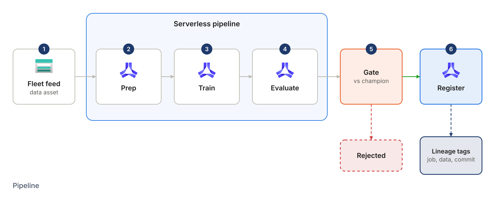
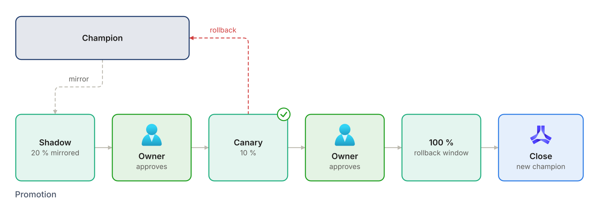

# Architecture

What Trainyard is made of, where each part runs, and its two paths end to end: a model cycle, from a retraining to a promotion or a rollback, and a planner's question answered by the agent through its tools. This page describes what `infra/main.bicep` deploys and what `app/` and `ml/` run; the runbooks are in [`OPERATIONS.md`](OPERATIONS.md) and the decisions in [`adr/`](adr/).

## Components and regions

Each environment is one resource group, `rg-trainyard-stg-swc` or `rg-trainyard-prod-swc`, deployed from the same template. Below, `<env>` is `stg` or `prod`.

| Component | Resource | Region | What runs there |
|---|---|---|---|
| App | `ca-trainyard-<env>`, a Container App on `cae-trainyard-env` | Germany West Central | one image: FastAPI (`app/main.py`), the built React client (`web/dist`), the agent (`app/agent.py`) and the promotion workflow with its one-minute timer (`app/promotion.py`); Easy Auth in front; 0 to 2 replicas in staging, 0 to 3 in production |
| Workspace | `mlw-trainyard-<env>-swc`, Azure Machine Learning | Sweden Central | the `fleet-feed` data asset, the four pipeline components, the training pipeline on serverless compute, the registered model `trainyard-risk` and the monitor schedule `trainyard-monitor` |
| Endpoint | `ep-trainyard-<env>`, a managed online endpoint | Sweden Central | the deployments `blue` and `green`, each one `Standard_DS1_v2` instance that runs `ml/score.py` with the data collector; `aad_token` only |
| Storage | `sttrainyard<env>swc` | Sweden Central | the workspace's storage: the feed, the job outputs, the models, and the inputs and outputs the endpoint collects; shared keys off, blob soft delete of 7 days |
| Key Vault | `kv-trainyard-<env>-swc` | Sweden Central | the workspace's vault, with RBAC; the template stores no secret in it |
| Telemetry | `appi-trainyard-<env>-swc`, Application Insights | Sweden Central | the app's OpenTelemetry data and the KPI and approval events, kept in the shared Log Analytics workspace; local auth off |
| State | `cosmos-trainyard-<env>-swc`, Cosmos DB serverless | Sweden Central | the database `trainyard`: `checkpoints` (the promotion workflow and its lease) and `conversations` (30-day TTL); local auth off, continuous backup of 7 days |
| Watch | a workbook, a log alert, three metric alerts and a budget | Sweden Central for the workbook and the log alert; the metric alerts and the budget have no region | SLA, SLO, KPI and health tiles; 5xx and p95 on the endpoint, 5xx on the app, failed runs in the workspace; 60 or 80 a month in the billing currency |
| Shared base | Container Registry, the Foundry account and project with the `gpt-5-mini` deployment, Log Analytics, the action group | the shared resource group; Log Analytics is in Sweden Central (ADR-017) | referenced as existing resources: the template only adds role assignments there (ADR-007) |

- **Two regions.** Everything an environment owns is in Sweden Central except its Container App. `cae-trainyard-env` and both apps are in Germany West Central (`appLocation` in `infra/main.bicep`), because the subscription allows one Container Apps environment per region and five in all (ADR-017); production declares that environment in its group and staging joins it (ADR-018).
- **Nothing at rest in Germany West Central.** The app handles requests in memory, and each call to Cosmos DB, the endpoint, the workspace or Application Insights crosses to Sweden Central, a 27 ms round trip (ADR-017).
- **The language model** is a Global Standard deployment, so prompts may be processed in any Azure region; they carry no personal data ([`PRODUCT.md`](PRODUCT.md)).
- **No private networking.** Every resource has a public endpoint behind Entra ID and TLS 1.2; there are no private endpoints and no managed virtual network ([`THREAT_MODEL.md`](THREAT_MODEL.md)).
- **Outside the Bicep.** The endpoint's deployments, the data assets, the registered models and the monitor schedule are the model lifecycle: the workflows and the app create them, and every Bicep deployment passes the endpoint's traffic back unchanged (ADR-004).

## A model cycle

### Training and the gate

1. **Feed.** A fleet feed operation, the `feed_days` input of `deploy.yml` or `release.yml`, runs `ops/feed.py` on the runner and registers a new version of the `fleet-feed` data asset in that environment's workspace (ADR-012).
2. **Request.** Three callers submit the same pipeline through `submit` in `ml/pipeline.py`: the owner in the chat, where `start_retraining` waits for the approval; `deploy.yml`, when a merge changed `ml/`, `app/domain/` or `data/`; and `release.yml`, on a published release. The job is named `training-<timestamp>` before it is submitted. It takes the latest feed version, the components registered with the running image's version and, as champion, the model that serves 100 % of live traffic.
3. **Run.** `prep`, `train`, `evaluate` and `register` run on serverless compute, one `Standard_F2s_v2` node each, as `id-trainyard-aml-<env>` (ADR-006). `prep` builds the features with `ml/features.py`, splits them by time and registers the training rows as the data asset `trainyard-reference`, the monitor's reference. `train` fits the LightGBM classifier, calibrates it and chooses the operating point within the inspection budget (ADR-003).
4. **Gate.** `evaluate` scores the challenger and the champion on the same holdout, the latest 56 days whose labels have matured, with the scorer the endpoint uses (`ml/score.py`). It applies the limits of `eval/thresholds.yaml`: recall of at least 0.80, precision of at least 0.60, a recall of at least 0.70 in every series, and at most 0.02 of recall below the champion ([`evaluation.md`](evaluation.md)).
5. **Register.** `register` obeys the gate. A model that fails is not registered; one that passes becomes a new version of `trainyard-risk` in MLflow, tagged with its data asset and version, its pipeline job, the git commit (the release tag in production, ADR-011), the gate decision, the champion it was compared with and its metrics (REQ-01). Registering changes nothing in what serves.

### Shadow, canary, promote or roll back

The promotion is a checkpointed Agent Framework workflow of four steps, `compare`, `shadow`, `canary` and `window` (`app/promotion.py`, ADR-009). Each step that changes traffic stops at a card in the chat that only a `ModelApprover` can answer (`POST /api/promotion`).

1. **Compare.** `start_promotion`, approved by the owner, refuses a version that is not registered, that was not compared with the current champion or that lost more than 0.02 of recall to it, and refuses any version while both slots are busy. When the endpoint has no champion yet, the first model goes to 100 % after one approval.
2. **Shadow.** The challenger is deployed to the free slot, `blue` or `green`, with the code and the environment registered for the image (`deployment` in `ml/pipeline.py`). A deployment takes about 10 minutes, and the timer runs the step again until it serves. Live traffic stays at 100 % on the champion and 20 % of it is mirrored to the challenger, whose answers nobody receives. The card shows the offline metrics and, for both deployments, the requests, the failures, the p95 and the agreement of their flags on this week's rows, read from the endpoint's logs over 30 minutes.
3. **Canary.** After the owner's approval, and only when the shadow is healthy and has 200 requests or 30 minutes, the challenger takes 10 % of live traffic. The app's timer checks it every minute: more than 0.3 % of failed requests, or a p95 of 400 ms or more, sends all traffic back to the champion and deletes the challenger. After 15 checks and 15 minutes the card offers the promotion.
4. **Promote.** A second approval sends 100 % to the challenger and creates the monitor schedule again on its deployment. The old champion stays deployed at 0 %: that is the rollback window.
5. **Close or roll back.** Closing the window deletes the old champion's deployment. A rollback, from the canary or inside the window, puts the champion back at 100 % in one traffic change and deletes the challenger.

- **State.** Every step is a checkpoint in the Cosmos DB container `checkpoints`, so a restart or another replica resumes where the workflow stopped. A lease document in the same container, written with optimistic concurrency, lets one replica at a time advance it. The app scales to zero, which stops the timer: a canary then waits at 10 % until the next request starts a replica (ADR-009).
- **Audit and KPIs.** Each approval is an `approval_given` event with a hash of the approver, the model and the step. The cycle's events, `retrain_completed`, `model_evaluated`, `model_promoted` and `model_rolled_back`, go to Application Insights and feed the workbook (ADR-016).
- **Monitor.** `trainyard-monitor` is a daily schedule at 03:15 UTC on serverless Spark with the generally available signals: data drift and data quality against the training rows, and prediction drift (ADR-010). In staging the app disables it at once, and it runs on demand. No run has completed in either environment, because the platform never starts its Spark steps: REQ-04 is not measured yet, the owner keeps the production schedule disabled ([`OPERATIONS.md`](OPERATIONS.md)), and `model_status` reports drift as unknown until a run completes.

## A planner's question

1. **Sign-in.** The browser loads the web client from the Container App. Easy Auth is the only way in: it redirects to Entra ID, excludes only `/healthz` and adds the `X-MS-CLIENT-PRINCIPAL` header to every request. `app/main.py` reads the app roles and the object id from that header: 401 without it, 403 without `Reader` or `ModelApprover`. The object id is kept only as a 16-character SHA-256 prefix (ADR-016).
2. **Turn.** `POST /api/chat` opens or loads the conversation and streams server-sent events: `conversation`, `text`, `approval`, `error` and `done`.
3. **Agent.** `build_agent` creates one Agent Framework agent on the shared `gpt-5-mini` deployment, reached through the Foundry project endpoint with the app's managed identity. The tools are filtered by role on the server before the model sees them: `fleet_risk`, `explain_unit` and `model_status` for both roles; `start_retraining`, `start_promotion` and `rollback` for a `ModelApprover` only, each with `always_require` approval (ADR-001).
4. **Data.** `fleet_risk` reads the latest `fleet-feed` version from the workspace storage and builds this week's rows, one per unit, with `ml/features.py`, the function that training uses. The rows are cached until a new feed version appears.
5. **Score.** The app posts the rows to the endpoint's scoring URI with an Entra token. `ml/score.py` returns, for each unit, the calibrated 7-day failure probability and every feature's contribution to it, with the model version and the threshold. The data collector stores the inputs and the outputs in that environment's storage (ADR-008).
6. **Answer.** `app/domain/fleet.py` ranks the flagged units within the inspection budget of 6 and puts the top signals into words. The tool returns that as JSON, and the model writes the table and copies each number. "Why is this unit at risk?" goes to `explain_unit`; "where does this score come from?" goes to `model_status`, which reads the endpoint's traffic, the registered models with their lineage tags, the promotion in progress and the monitor.
7. **After the answer.** The conversation is saved in the Cosmos DB container `conversations` under the user's hash, expires after 30 days and can be deleted with `DELETE /api/conversations/{id}` (REQ-10). A thumbs up or down is a `feedback_given` event (REQ-09). When the model, the endpoint or the store is down or throttled, the app answers 503 or 429 with `Retry-After` and a sentence that says when to try again.

The same list is served without the language model at `GET /api/fleet/risk`.

## Identities and roles

No key or connection secret exists: every call is authenticated with Entra ID (ADR-006).

| Identity | Roles and scope | Used for |
|---|---|---|
| `id-trainyard-app-<env>` | AzureML Data Scientist (workspace); Managed Identity Operator (the two identities below); Monitoring Reader (endpoint); Storage Blob Data Reader (workspace storage); Monitoring Metrics Publisher (Application Insights); Cosmos DB Built-in Data Contributor (database `trainyard`); AcrPull (shared registry); Cognitive Services OpenAI User (Foundry account); Foundry User (Foundry project) | the Container App: pulls the image, calls the language model, reads the feed, scores, reads the traffic log, submits the pipeline as the workspace identity, changes deployments and traffic, writes conversations, checkpoints and telemetry |
| `id-trainyard-aml-<env>` | Azure AI Administrator (workspace, its storage, Key Vault and Application Insights, and the shared registry); Key Vault Administrator (Key Vault); Storage Blob Data Contributor (workspace storage); AcrPull (shared registry) | the workspace's primary identity, every pipeline node and the monitor's Spark steps |
| `id-trainyard-ep-<env>` | AcrPull (shared registry); Storage Blob Data Contributor (workspace storage) | the endpoint: pulls the image, reads the model, writes the collected data |
| `gh-product-infra-trainyard-<env>` | Contributor on its own resource group, with the right to assign only the roles its conditions list; Storage Blob Data Contributor on the workspace storage, which the template grants to the deploying principal | GitHub Actions through OIDC, one federated credential per GitHub environment; on `cae-trainyard-env` the staging principal holds only `read` and `join/action` (ADR-018) |

- **Users.** `Reader`, for planners, and `ModelApprover`, for the model owner, are app roles of the sign-in app registration. The server checks them on every request, and `/api/promotion` answers 403 to a `Reader` (ADR-016).
- **Pull requests.** `eval.yml` signs in with a federated credential for pull requests (`AZURE_PR_CLIENT_ID`) and runs the agent evaluation against the shared model ([`evaluation.md`](evaluation.md)).

## Environments and promotion

- **Local.** The tests run with a scripted model and a double of Azure Machine Learning and the endpoint (`tests/doubles.py`): no Azure resource is needed.
- **Staging and production** come from the same template, and `env` is the only switch: 2 or 3 replicas at most, a budget of 60 or 80, Key Vault purge protection in production only, and production declares `cae-trainyard-env`.
- **Code moves as one image.** `ci.yml` and, when the agent can change, `eval.yml` run on every pull request. A merge to `main` builds the image once, and `deploy.yml` deploys it to staging by digest and records that digest on the commit as the status `staging-image`. `load-test.yml` records `load-test/normal`, `load-test/peak` and `load-test/endurance`. A published release runs `release.yml`: its `verify` job requires those statuses (ADR-019 exempts a release without runtime changes from the load tests), and its `production` job deploys the same digest after the owner approves the `production` environment.
- **Every deployment** (`.github/actions/ship`) reads the endpoint's live and mirrored traffic, runs `what-if`, deploys with that traffic unchanged, checks `/healthz` and registers the four ML components with the image's version.
- **Models do not move between environments.** There is no Azure Machine Learning registry: each environment trains its own model with the promoted code on its own feed, and the owner promotes it from the chat, as above (ADR-002).

| Module | Resources |
|---|---|
| `infra/main.bicep` | the three user-assigned identities, Managed Identity Operator for the app on the other two, the references to the shared base and the app's settings |
| `modules/shared.bicep` | role assignments in the shared resource group: AcrPull for the three identities, Azure AI Administrator on the registry for the workspace identity, and the two model roles for the app |
| `modules/ml.bicep` | Storage, Key Vault, Application Insights, the workspace (data isolation, identity-based datastores), the endpoint with the traffic it is given, their roles and the diagnostic settings |
| `modules/app.bicep` | Cosmos DB with its two containers and its data-plane role, the Container App (single revision, probes on `/healthz`, an HTTP scale rule) and Easy Auth |
| `modules/environment.bicep` | `cae-trainyard-env`, on the Consumption profile and without zone redundancy, and its diagnostic setting; deployed by production only (ADR-018) |
| `modules/monitor.bicep` | the workbook built from `infra/workbook.json`, the three metric alerts, the log alert on failed runs and the budget |
| `modules/roles.bicep` | the built-in role ids, shared by the modules |
